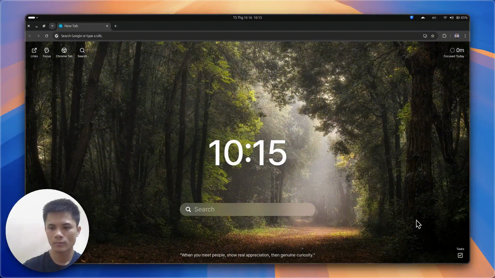

<p align="center">
  
</p>

<h1 align="center">DemoThat</h1>

<p align="center">
  <strong>Record your screen, let DemoThat auto-zoom the action, and publish a shareable clip.</strong><br />
  <sub>Free and open source · cinematic pan-and-zoom, with no manual keyframing.</sub>
</p>

<p align="center">
  <a href="https://github.com/getwithashish/DemoThat/actions/workflows/checks.yml"></a>
  <a href="https://github.com/getwithashish/DemoThat/actions/workflows/release.yml"></a>
  <a href="LICENSE"></a>
  <a href="https://nodejs.org/en/about/previous-releases"></a>
</p>

---

## 🎥 Demo



## ✨ What it does

- **Flexible capture** — record the full screen, a window, or a custom region, with optional webcam and microphone.
- **Cinematic mouse tracking** — follows your mouse and clicks, generating smooth pan-and-zoom effects with no manual keyframing.
- **Visual editor** — trim on a timeline, then style with backgrounds, frames, shadows, and reusable presets.
- **Instant aspect ratios** — switch between 16:9, 9:16 (Shorts/TikTok), and 1:1 (Instagram) in one click.
- **Caption cleanup** — transcribes the audio and removes filler words (um, uh, ...) from the captions.
- **High-quality export** — export to MP4 or GIF at up to 2K.
- **Publishing** — publish a finished clip as a landing page or embed through the DemoThat cloud service.

Some features (credits, cloud upscaling, publishing, Pro licensing) talk to a DemoThat API. The app ships pointing at the production API; see [Working against a local API](#working-against-a-local-api) to run it against a mock instead.

## ✅ Prerequisites

- **Node.js 22** (`engines` pins `>=18 <=22`). Use 22, not 24: the `postinstall` step (`electron-builder install-app-deps`) fails on Node 24. CI and the release workflow both pin 22.
- **FFmpeg binaries** for your OS, placed under `binaries/<os>/` (see [Install](#install)).
- **Platform build tooling** for the native optional dependencies:
  - **Windows:** [Build Tools for Visual Studio 2022](https://visualstudio.microsoft.com/visual-cpp-build-tools/) with the "Desktop development with C++" workload, and Python 3.8 on `PATH`.
  - **macOS:** Xcode Command Line Tools, and Python 3.8 on `PATH`.
  - **Linux:** X11 and Wayland both work; Wayland capture needs `xdg-desktop-portal` and PipeWire (default on recent GNOME, KDE, and Sway installs).

The repo ships a `package-lock.json`, so use **npm**.

## 📦 Install

```bash
git clone https://github.com/getwithashish/DemoThat.git
cd DemoThat
npm ci
```

`npm ci` runs `postinstall`, which rebuilds native app dependencies and patches Electron's `Info.plist`.

FFmpeg is not vendored; download it into `binaries/<os>/`:

```bash
# Linux
wget https://github.com/tamnguyenvan/screenarc-assets/releases/download/v0.0.1/ffmpeg-linux-x64 -O binaries/linux/ffmpeg && chmod +x binaries/linux/ffmpeg

# macOS (Apple Silicon)
wget https://github.com/tamnguyenvan/screenarc-assets/releases/download/v0.0.1/ffmpeg-darwin-arm64 -O binaries/darwin/ffmpeg-arm64 && chmod +x binaries/darwin/ffmpeg-arm64

# macOS (Intel)
wget https://github.com/tamnguyenvan/screenarc-assets/releases/download/v0.0.1/ffmpeg-darwin-x64 -O binaries/darwin/ffmpeg-x64 && chmod +x binaries/darwin/ffmpeg-x64

# Windows
wget https://github.com/tamnguyenvan/screenarc-assets/releases/download/v0.0.1/ffmpeg.exe -O binaries/windows/ffmpeg.exe
```

## 🚀 Run

```bash
npm run dev       # Vite dev server with HMR and the Electron shell
```

## 🏗️ Build

```bash
npm run build        # typecheck (tsc) + Vite production build into dist/ and dist-electron/
npm run dist:linux   # packaged Linux installers (AppImage, deb, rpm, zip)
npm run dist:win     # packaged Windows installer (NSIS)
npm run dist:mac     # packaged macOS dmg + zip (universal)
```

Packaging runs `tsc`, the Vite build, and then `electron-builder` (configured by the `build` block in `package.json`). The Linux `dist:*` scripts compile the native cursor helper first via `build:helper`. The `publish-*` scripts are for maintainers pushing release assets.

## 🧰 Scripts

| Script                                                      | What it does                                                                                                                            |
| ----------------------------------------------------------- | --------------------------------------------------------------------------------------------------------------------------------------- |
| `dev`                                                       | Start Vite + Electron in development with HMR.                                                                                          |
| `build`                                                     | Clean, typecheck (`tsc`), and run the Vite production build.                                                                            |
| `clean`                                                     | Remove `dist/` and `dist-electron/`.                                                                                                    |
| `preview`                                                   | Serve the built renderer with `vite preview`.                                                                                           |
| `test` / `test:watch`                                       | Run the Vitest suite once / in watch mode.                                                                                              |
| `lint` / `lint:fix`                                         | ESLint over `ts`/`tsx` (zero warnings) / auto-fix.                                                                                      |
| `format` / `format:check`                                   | Prettier write / check.                                                                                                                 |
| `build:helper`                                              | Compile the native cursor helper (`scripts/build-cursor-helper.sh`).                                                                    |
| `dist`                                                      | Full packaged build for the current platform.                                                                                           |
| `dist:linux` / `dist:win` / `dist:mac`                      | Packaged builds per platform (`dist:appimage`, `dist:deb`, `dist:rpm`, `dist:zip`, `dist:flatpak`, `dist:mac-arm64` target one format). |
| `publish-linux-app` / `publish-win-app` / `publish-mac-app` | Packaged build plus upload to the current GitHub release.                                                                               |
| `contract:check`                                            | Verify the vendored API contract version is pinned and consistent.                                                                      |
| `contract:types`                                            | Regenerate `shared/api-types.ts` from `contract/openapi.yaml`.                                                                          |
| `patch:electron-info-plist`                                 | Apply the macOS `Info.plist` patch (also runs in `postinstall`).                                                                        |
| `postinstall`                                               | Rebuild native deps and patch `Info.plist`.                                                                                             |

## 🗂️ Project structure

| Path                                         | Contents                                                                                                        |
| -------------------------------------------- | --------------------------------------------------------------------------------------------------------------- |
| `src/`                                       | React renderer: recorder, editor, and renderer pages, Zustand store, UI components.                             |
| `electron/`                                  | Electron main process, preload bridge, and their unit tests.                                                    |
| `shared/`                                    | Framework-free TypeScript (captions, fillers, export, pricing, cloud plans) used by both processes, with tests. |
| `contract/`                                  | Pinned vendored copy of the DemoThat API OpenAPI contract plus generated types.                                 |
| `scripts/`                                   | Build, contract, and FFmpeg helpers, plus a mock API server.                                                    |
| `binaries/`                                  | Per-OS FFmpeg and cursor-helper binaries (not committed builds; fetched or compiled).                           |
| `native/`, `build/`, `resources/`, `public/` | Native helper source, electron-builder resources/icons, macOS entitlements, static assets.                      |
| `docs/`                                      | Development notes, project structure, and platform plans.                                                       |

## 🧪 Testing

```bash
npm test          # vitest run
npm run test:watch
```

The Vitest suite (`vitest.config.ts`) covers `electron/**`, `src/**`, and `shared/**`. Tests run in a plain Node environment with `electron` and `electron-log` stubbed, so they exercise the pure logic: caption/filler-word removal, transcript and subtitle handling, export codecs/resolutions/caps, upscale and cloud-job planning, pricing and publish cost, license token handling, and API config. No coverage threshold is configured, so no coverage number is claimed here.

## 🔌 Working against a local API

The app reads its API base URL from `DEMOTHAT_API_BASE_URL` and otherwise uses the production host. For local development, a mock server implements the endpoints the app calls (checkout, license activation, cloud jobs, publishing, JWKS) with the same shapes and error codes as the pinned contract:

```bash
node scripts/mock-api-server.mjs          # listens on :8788 by default
DEMOTHAT_API_BASE_URL=http://localhost:8788 npm run dev
```

`DEMOTHAT_FORCE_PRO=1` unlocks Pro features without a key for development. Server-side behaviour is out of scope for this repo; `scripts/mock-api-server.mjs` is the reference for what the app expects.

## 🤝 Contributing

1. Fork the repo and create a descriptive branch: `feature/your-feature` or `fix/issue-number`.
2. Make your change; verify `npm run dev` still works and `npm test` passes.
3. Commit using [Conventional Commits](https://www.conventionalcommits.org/) (e.g. `feat: add webcam overlay`). Releases are automated from these messages.
4. Run the gates locally before pushing: `npm run lint`, `npm run format:check`, `npx tsc --noEmit`, `npm test`.
5. Open a pull request against `main` and fill in the PR template. PRs are squash-merged.

CI (`.github/workflows/checks.yml`) runs on every pull request and push to `main`: contract-version check, ESLint, Prettier check, typecheck, tests, and a diff check that `shared/api-types.ts` is regenerated from the pinned contract. A change that fails any of these cannot merge.

Commits use the [Conventional Commits](https://www.conventionalcommits.org/) types (`fix`/`perf` → patch, `feat` → minor, `feat!` or `BREAKING CHANGE:` → major; `docs`, `chore`, `refactor`, `test`, `ci`, `style` produce no release). On merge to `main`, `.github/workflows/release.yml` runs semantic-release and, when a release is cut, builds and attaches artifacts for Linux, Windows, and macOS.

See [CONTRIBUTING.md](CONTRIBUTING.md) and [CODE_OF_CONDUCT.md](CODE_OF_CONDUCT.md).

## 📜 License

DemoThat is licensed under the [GNU General Public License v3.0](LICENSE) (GPL-3.0).

- Copyright (C) 2025 Tam Nguyen (original ScreenArc)
- Copyright (C) 2026 Ashish Sam (modifications in DemoThat)

DemoThat is a fork of [ScreenArc](https://github.com/tamnguyenvan/screenarc) by Tam Nguyen, modified and maintained by Ashish Sam; original copyright notices are retained as required by the GPL, and the complete corresponding source for every release is available in this repository.
